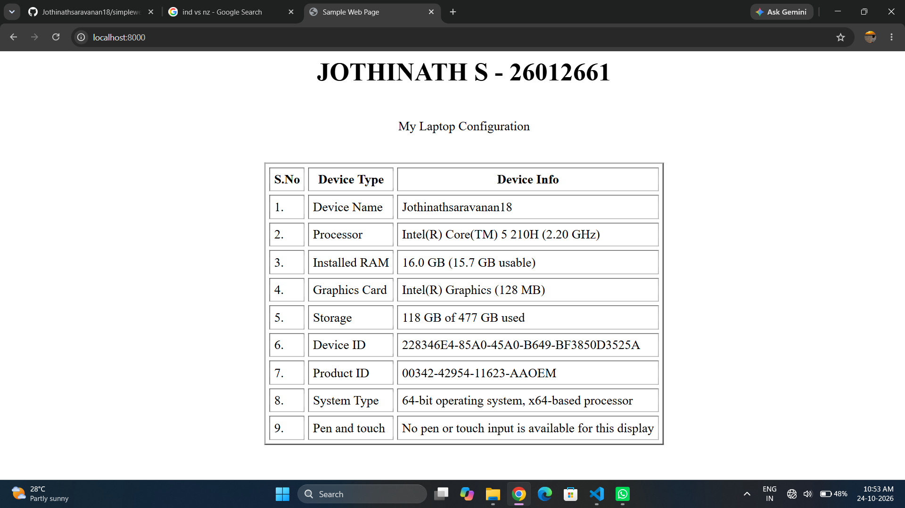
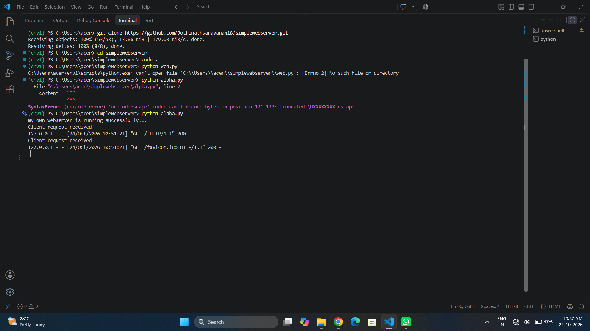

# EX01 Developing a Simple Webserver
## Date: 28.09.2026

## AIM:
To develop a simple webserver to serve html pages and display the Windows Specifications of your Laptop.

## DESIGN STEPS:
### Step 1: 
HTML content creation.

### Step 2:
Design of webserver workflow.

### Step 3:
Implementation using Python code.

### Step 4:
Import the necessary modules.

### Step 5:
Define a custom request handler.

### Step 6:
Start an HTTP server on a specific port.

### Step 7:
Run the Python script to serve web pages.

### Step 8:
Serve the HTML pages.

### Step 9:
Start the server script and check for errors.

### Step 10:
Open a browser and navigate to http://127.0.0.1:8000 (or the assigned port).

## PROGRAM:
```
alpha.py
<html>
    <head>
        <title>Sample Web Page</title>
    </head>
    <body>
       <h1><Center>JOTHINATH S - 26012661 </Center></h1><br>
        

            <Center>My Laptop Configuration </Center><<br>
        <BR>

       <center><table border = "2" cellpadding = "5" cellspacing = "5">
           
            <tr>
                <th>S.No</th>
                <th>Device Type</th>
                <th>Device Info</th>
            </tr>
            <tr>
                <td>1.</td>
                <td>Device Name</td>
                <td>Jothinathsaravanan18</td>
            </tr>
            <tr>
                <td>2.</td>
                <td>Processor</td>
                <td>Intel(R) Core(TM) 5 210H (2.20 GHz)</td>
            </tr>
            <tr>
                <td>3.</td>
                <td>Installed RAM</td>
                <td>16.0 GB (15.7 GB usable)</td>
            </tr>
            <tr>
                <td>4.</td>
                <td>Graphics Card</td>
                <td>Intel(R) Graphics (128 MB)</td>
            </tr>           
            <tr>
                <td>5.</td>
                <td>Storage</td>
                <td>118 GB of 477 GB used</td>
            </tr>   
            <tr>
                <td>6.</td>
                <td>Device ID</td>
                <td>228346E4-85A0-45A0-B649-BF3850D3525A</td>
            </tr>
            <tr>
                <td>7.</td>
                <td>Product ID</td>
                <td>00342-42954-11623-AAOEM</td>
            </tr>
            <tr>
                <td>8.</td>
                <td>System Type</td>
                <td>64-bit operating system, x64-based processor</td>
            </tr>
            <tr>
                <td>9.</td>
                <td>Pen and touch</td>
                <td>No pen or touch input is available for this display</td>
            </tr>
        </table></center>
    </body>
</html>
```

## OUTPUT:
Webpage


Server Page


## RESULT:
The program for implementing simple webserver is executed successfully.
